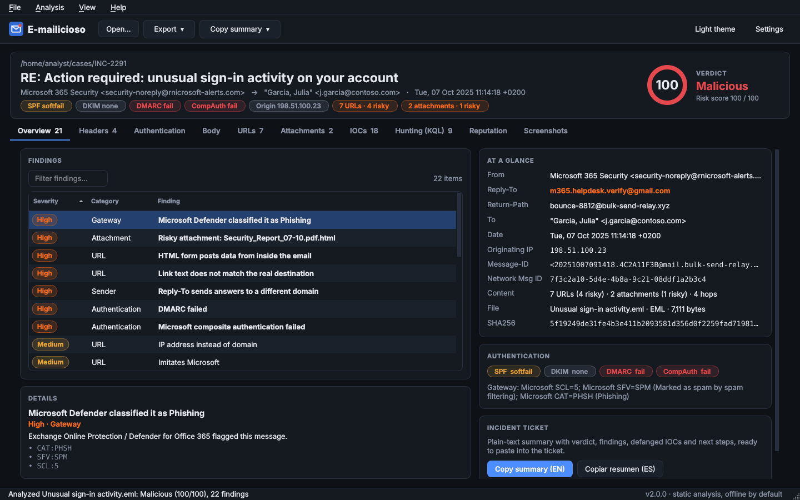
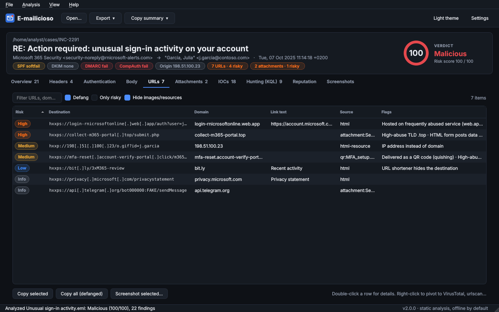
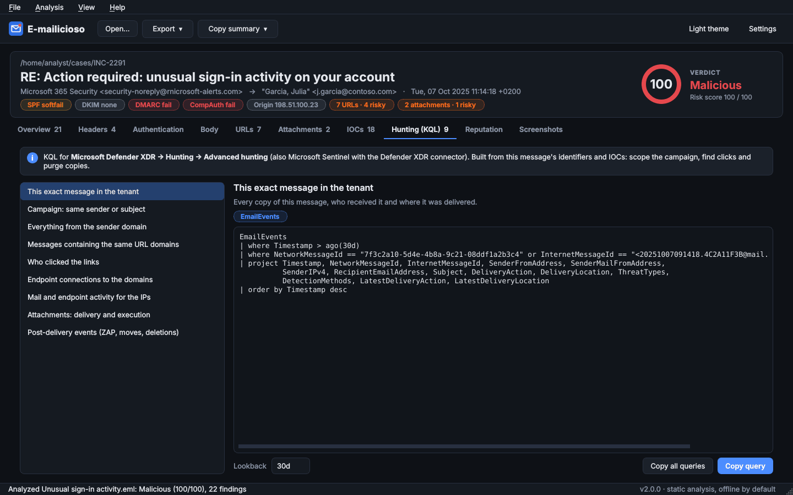
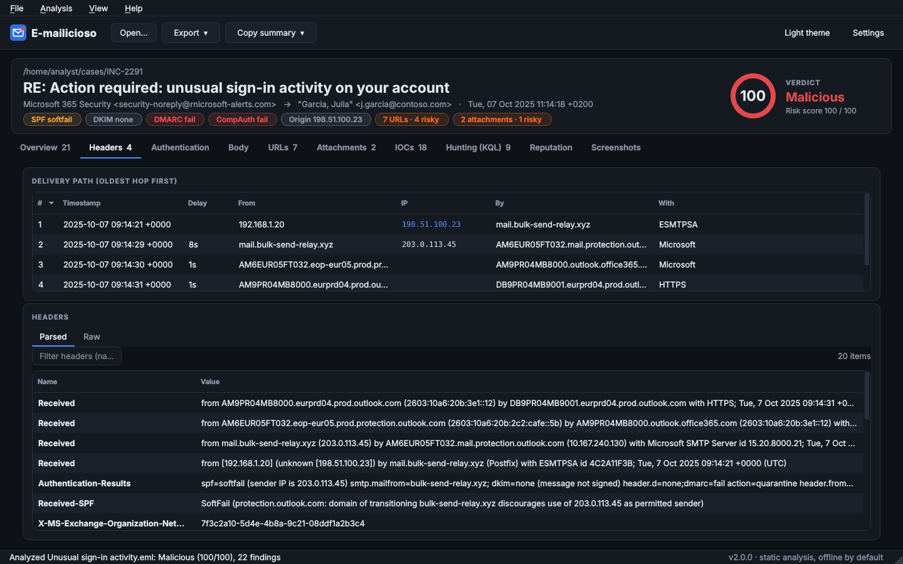
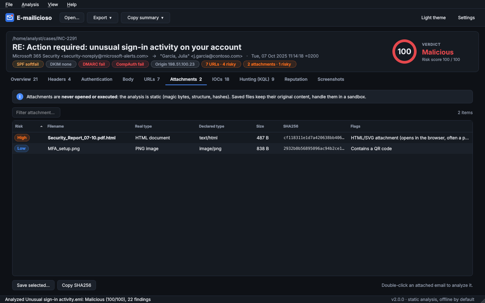
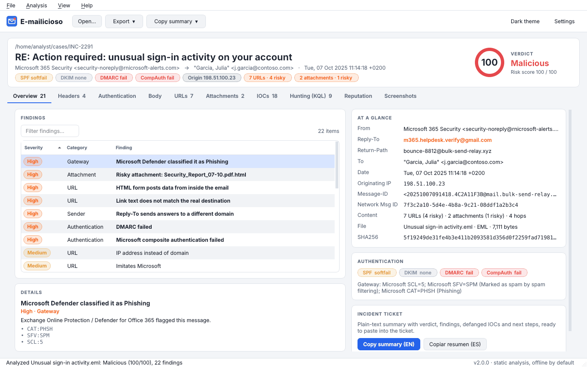
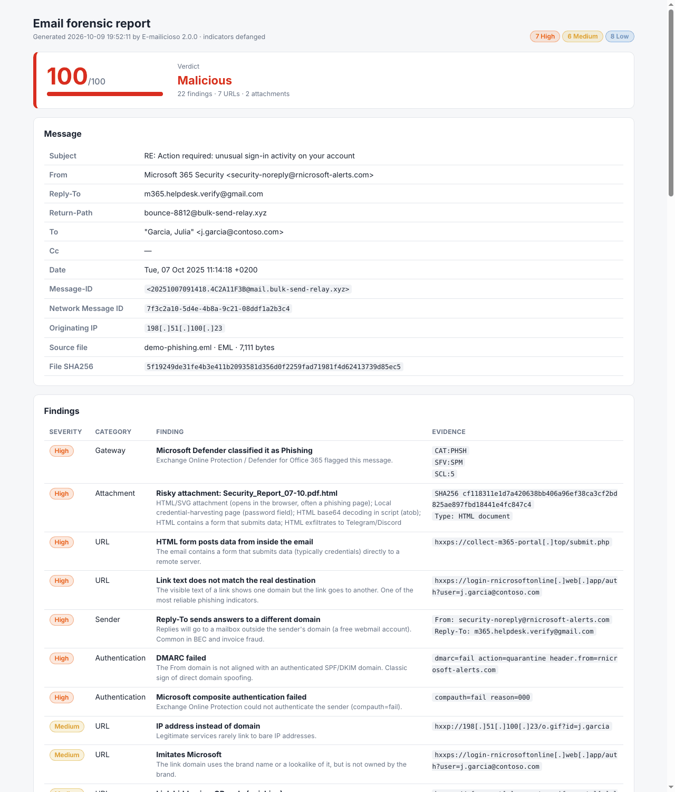

<div align="center">

# 📧 E-mailicioso

**Portable email forensics for SOC analysts.**
Drop a suspicious `.eml` or `.msg` and get a verdict, the evidence behind it, defanged IOCs and ready-to-run KQL, without sending anything to the cloud.

[](https://github.com/acarranza-labs/E-mailicioso/actions/workflows/ci.yml)




</div>

---

## Why

Triage of reported phishing is repetitive: open the headers, check SPF/DKIM/DMARC, follow the hops, decode Safe Links,
hover every link, hash the attachments, copy IOCs into the ticket, write the hunting query to see who else got it...
E-mailicioso does all of that in one pass, explains **why** something is suspicious, and hands you the outputs you
actually paste somewhere: a ticket summary, an IOC list and KQL for Microsoft Defender XDR / Sentinel.

Everything is **static and local**. Links are never visited and attachments are never opened unless you explicitly ask
for a screenshot or a reputation lookup.

## Features

**Verdict you can explain**
- 0–100 risk score with a verdict (*No indicators → Low risk → Suspicious → High risk → Malicious*), built from
  dozens of checks. Every point comes from a finding you can read, with its evidence.

**Headers & authentication**
- SPF, DKIM, DMARC, ARC and Microsoft `compauth` from the topmost `Authentication-Results` (plus `Received-SPF`).
- Delivery path: every `Received` hop in chronological order with delays, real connecting IPs (not the HELO) and the
  **originating IP**. Flags timestamps that go backwards and backdated `Date` headers.
- Security gateway verdicts: **Microsoft EOP/Defender** (`SCL`, `SFV`, `CAT:PHSH`…, `BCL`), **Proofpoint**
  (phish/spam/malware scores), SpamAssassin, Mimecast, Barracuda.
- Sender checks: Reply-To diverted to another domain (BEC), display-name spoofing (`"ceo@corp.com" <x@gmail.com>`),
  brand in display name, **lookalike domains** (`paypa1`, `rnicrosoft`, punycode/IDN, brand-in-domain), freemail,
  high-abuse TLDs, fake `RE:` threads.

**Links**
- Unwraps **Microsoft Safe Links**, **Proofpoint URL Defense v1/v2/v3**, Barracuda, Trend Micro, Google and generic
  redirectors (including base64 parameters), even when nested.
- Flags **link text that shows one domain and points to another**, `@` userinfo tricks, IPs, shorteners, abused
  hosting (`web.app`, `pages.dev`, `ngrok`, IPFS…), direct downloads, HTML forms inside the email, meta refresh,
  tracking pixels.
- Extracts links from HTML/SVG/PDF/text attachments and decodes **QR codes** in images (quishing).

**Attachments** (never executed)
- MD5/SHA1/SHA256 and real file type from magic bytes, so `invoice.pdf` that is really an `.exe` gets caught.
- Double extensions, right-to-left override, executables/scripts, ISO/IMG/VHD, OneNote, macro-enabled Office,
  **VBA macros inside OOXML**, remote template injection, password-protected ZIPs, risky files inside archives,
  PDF JavaScript/Launch/embedded files, RTF OLE objects, **HTML smuggling** and credential-harvesting HTML/SVG pages.
- Attached emails (`message/rfc822`, `.msg`) open as a new analysis with one click, the usual case when a user
  reports a phish *as an attachment*. A back button returns to the parent.

**Content**
- Credential lures and urgency (English and Spanish), **BEC bank-detail changes** with IBAN validation, callback
  phishing (TOAD), crypto wallets, hidden text used to poison filters, image-only bodies.

**Outputs**
- **IOCs**: IPs, domains, URLs, email addresses and hashes, defanged or not, as text/CSV/JSON. Legitimate
  infrastructure (Microsoft, Google, link wrappers, shorteners, the recipients) is left out so the list can be
  blocked as-is.
- **Hunting (KQL)**: 9 ready-to-run queries for Defender XDR Advanced Hunting / Sentinel: every copy of the message
  (`NetworkMessageId`/`InternetMessageId`), campaign by sender/subject, same URL domains, **who clicked**
  (`UrlClickEvents`), endpoint connections, attachment delivery and execution, ZAP/post-delivery actions.
- **Ticket summary** in English or Spanish: verdict, key findings, defanged IOCs and recommended actions.
- **HTML report** (print-friendly, light/dark) and full **JSON** export.

**Optional, opt-in enrichment**
- Reputation: **VirusTotal**, **AbuseIPDB** (free API keys), **urlscan.io** search and URLVoid, with a local
  cache. Lookups only, nothing is ever submitted. Right-click any indicator to pivot to VirusTotal, urlscan, Talos,
  Shodan, MalwareBazaar…
- **Evidence screenshots** of URLs with headless Chromium, optionally through a proxy, saved with a JSON sidecar
  (final URL, redirects, HTTP status, SHA256 of the image).

## Screenshots

| Links unwrapped and scored | KQL hunting |
|---|---|
|  |  |
| **Delivery path and headers** | **Attachment triage** |
|  |  |
| **Light theme** | **HTML report** |
|  |  |

## Quick start

```bash
git clone https://github.com/acarranza-labs/E-mailicioso.git
cd E-mailicioso
python -m venv .venv
.venv\Scripts\activate            # Windows
# source .venv/bin/activate       # Linux / macOS
pip install -r requirements.txt

python main.py                                  # open the GUI
python main.py samples/demo-phishing.eml        # open the GUI with a file
```

Click **Try the demo phishing sample** on the welcome screen to see every feature on a synthetic phish.

`requirements.txt` installs everything. If you only want the essentials, `pip install -e .[gui]` gives the GUI and
the core; add `msg` (Outlook files), `qr` (QR codes) or `screenshots` as needed, or `all`. Screenshots also need a
browser: `python -m playwright install chromium`.

## Command line

The same engine runs headless, for scripts, SOAR playbooks or bulk triage:

```bash
python -m emailicioso analyze suspicious.eml                     # coloured summary
python -m emailicioso analyze suspicious.eml -f summary --lang es  # ticket summary in Spanish
python -m emailicioso analyze suspicious.eml -f iocs-csv > iocs.csv
python -m emailicioso analyze suspicious.eml -f kql --lookback 7d
python -m emailicioso analyze inbox/*.eml --html reports/ --json reports/
python -m emailicioso analyze suspicious.eml -f json --fail-on high   # exit code 2 if High or worse
```

Installed with `pip install .`, the same commands are available as `emailicioso …`.

```text
[MALICIOUS] score 100/100  samples/demo-phishing.eml
  Subject : RE: Action required: unusual sign-in activity on your account
  From    : Microsoft 365 Security <security-noreply@rnicrosoft-alerts.com>
  Reply-To: m365.helpdesk.verify@gmail.com
  Orig. IP: 198.51.100.23
  Auth    : SPF=softfail  DKIM=none  DMARC=fail  CompAuth=fail

  HIGH     Gateway        Microsoft Defender classified it as Phishing
  HIGH     Attachment     Risky attachment: Security_Report_07-10.pdf.html
  HIGH     URL            Link text does not match the real destination
  HIGH     Sender         Reply-To sends answers to a different domain
  ...
```

## OPSEC and privacy

- Opening an email is **offline**: parsing, scoring, IOC extraction, KQL and reports never touch the network (the
  Public Suffix List is bundled, no download).
- The HTML body is rendered with **remote content blocked** and links disabled. Hovering a link shows its real,
  unwrapped destination in the status bar.
- **Reputation lookups** disclose indicators to third parties, so they are **off by default** and run only when you
  click *Run lookups* (or enable automatic mode in Settings).
- **Screenshots visit the live URL**. The app asks for confirmation every time and can route the browser through a
  proxy (`socks5://…`, `http://…`). Prefer an isolated network.
- Saved attachments keep their original content: handle them in a sandbox.

## Configuration

Settings live in `~/.emailicioso/settings.json` (or the folder in `EMAILICIOSO_HOME`) and are editable from
**Settings** in the app: theme, summary language, KQL lookback, defanging, API keys, cache TTL, evidence folder,
proxy and timeout for screenshots.

API keys can also come from the environment: `EMAILICIOSO_VT_API_KEY` (or `VT_API_KEY`),
`EMAILICIOSO_ABUSEIPDB_API_KEY` (or `ABUSEIPDB_API_KEY`), `EMAILICIOSO_URLSCAN_API_KEY`.

Keyboard: `Ctrl+O` open · `Ctrl+E` HTML report · `Ctrl+Shift+C` copy ticket summary · `Ctrl+Shift+I` copy IOCs ·
`Ctrl+1…9` switch tabs · `Alt+←` back to the parent email · `F5` re-analyze · `Ctrl+T` theme.

## How the score works

Each finding has a severity with a fixed weight (Critical 40, High 25, Medium 12, Low 5, Info 0). The score is the
sum, capped at 100, with Low findings capped at 20 so many weak signals can't outweigh one strong one. Any Critical
finding (for example an executable attachment) makes the verdict *Malicious*. Thresholds: 8 Low, 25 Suspicious,
50 High, 80 Malicious. It is a triage aid, not a replacement for the analyst's judgement.

## Project layout

```text
emailicioso/
├── cli.py                 # `emailicioso` / `python -m emailicioso` (GUI or headless analyze)
├── core/                  # pure Python engine, no GUI dependency
│   ├── parser.py          # .eml / .msg parsing (robust to malformed MIME, keeps every header)
│   ├── headers.py         # authentication, hops, sender checks, gateway verdicts
│   ├── urls.py            # extraction, Safe Links / Proofpoint unwrapping, per-URL flags
│   ├── attachments.py     # hashes, magic bytes, macros, smuggling, archives, PDFs
│   ├── content.py         # lures, BEC, IBAN, callback phishing, hidden text
│   ├── domains.py         # PSL (offline), lookalikes, defang/refang
│   ├── scoring.py · iocs.py · hunting.py · report.py · qr.py · screenshots.py
│   └── reputation/        # VirusTotal, AbuseIPDB, urlscan.io, URLVoid, pivots, cache
└── ui/                    # PySide6 interface (tabs, theme, widgets, background jobs)
samples/demo-phishing.eml  # synthetic phishing sample (fictitious data)
tests/                     # pytest suite (parser, detections, CLI, GUI smoke test)
```

## Development

```bash
pip install -e ".[all,dev]"
pytest          # ~90 tests, GUI test runs offscreen
ruff check .
```

Ideas and pull requests are welcome. For larger changes, open an issue first.

## License

[MIT](LICENSE)

## Disclaimer

Intended for **security operations, incident response and research**. Only analyze emails you are authorized to
handle. The verdict is produced by heuristics and can be wrong in both directions.
